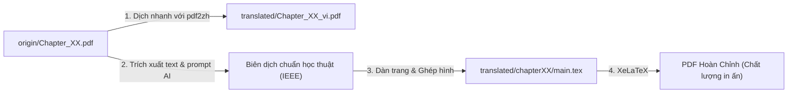

# 📖 Hands-On Machine Learning with Scikit-Learn and PyTorch (Bản Dịch Tiếng Việt)

> **Dự án dịch thuật và biên soạn tiếng Việt từng chương cuốn sách kinh điển:**  
> *Hands-On Machine Learning with Scikit-Learn and PyTorch* (O’Reilly, Release 2025) – Tác giả: **Aurélien Géron**.

[](#-tiến-độ-dịch-thuật)
[](#-tuyên-bố-bản-quyền--miễn-trừ-trách-nhiệm)
[](#-biên-tập-bản-latex-chuyên-nghiệp)

---

## 📌 Giới Thiệu Dự Án

Cuốn sách **Hands-On Machine Learning with Scikit-Learn and PyTorch** của Aurélien Géron là một trong những tài liệu thực hành toàn diện và cập nhật nhất thế giới về Machine Learning và Deep Learning. Phiên bản mới đã chuyển trọng tâm phần Deep Learning sang **PyTorch** và bổ sung sâu về Transformers, LLM, Vision Transformers, và Tối ưu mô hình.

Mục tiêu của dự án này là:
1. **Dịch thuật chính xác, tự nhiên và chuẩn học thuật** (theo phong cách IEEE/ACM) toàn bộ 19 chương sách và phụ lục sang tiếng Việt.
2. **Xuất bản song song 2 định dạng**:
   - Bản đọc nhanh / Sơ bộ (PDF dịch tự động bằng `pdf2zh` đã cân chỉnh layout).
   - Bản sách chuẩn in ấn chất lượng cao dàn trang bằng **$\text{\LaTeX}$ (XeLaTeX)** với font tiếng Việt sắc nét (*Be Vietnam Pro*).
3. **Chuẩn hóa thuật ngữ AI/ML** cho cộng đồng học tập và nghiên cứu tại Việt Nam.

---

## 📂 Cấu Trúc Thư Mục

```text
Hands-On ML/
├── Hands-On ML(2025 October, O’Reilly).pdf   # Toàn bộ sách gốc tiếng Anh
├── origin/                                   # File PDF gốc tách riêng theo từng chương
│   ├── Chapter_01.pdf
│   ├── Chapter_02.pdf
│   └── ... (Chapter 01 -> 19)
├── translated/                               # Thư mục lưu trữ bản dịch tiếng Việt
│   ├── Chapter_01 vi-1.pdf                   # Bản dịch PDF sơ bộ (pdf2zh)
│   ├── Chapter_02_vi.pdf
│   ├── Chapter_03 vi.pdf
│   ├── Chapter_04 vi.pdf
│   └── chapter2/                             # Bản biên dịch chuyên sâu LaTeX (Chương 2)
│       ├── main.tex                          # Master LaTeX file
│       ├── sections/                         # Các phần nội dung chi tiết
│       │   ├── 01_big_picture.tex
│       │   ├── 02_get_data.tex
│       │   └── ...
│       └── images/                           # Hình ảnh minh họa trích xuất
├── prompt_ieee.txt                           # System prompt chuẩn học thuật IEEE dịch bằng AI
├── tool-translates.txt                       # Cheat-sheet lệnh dịch nhanh bằng pdf2zh
└── README.md                                 # Tài liệu hướng dẫn & theo dõi tiến độ
```

---

## 📊 Tiến Độ Dịch Thuật

> **Ghi chú trạng thái:**
> - ⏳ *Chưa bắt đầu*
> - 🔄 *Đang thực hiện*
> - 📄 *Đã có bản dịch sơ bộ (pdf2zh)*
> - 🖋️ *Đã có bản dàn trang $\text{\LaTeX}$*
> - ✅ *Hoàn thành & Đã Review*

### Phần I: Nền Tảng Machine Learning (The Fundamentals of Machine Learning)

| Chương | Tiêu Đề Tiếng Anh | Tiêu Đề Tiếng Việt Dự Kiến | Bản PDF Sơ Bộ | Bản $\text{\LaTeX}$ | Review |
|:---:|:---|:---|:---:|:---:|:---:|
| **01** | The Machine Learning Landscape | Bức Tranh Toàn Cảnh về Machine Learning | 📄 | ⏳ | 🔄 |
| **02** | End-to-End Machine Learning Project | Dự Án Machine Learning Toàn Diện từ A–Z | 📄 | 🖋️ | 🔄 |
| **03** | Classification | Bài Toán Phân Lớp (Classification) | 📄 | ⏳ | ⏳ |
| **04** | Training Models | Huấn Luyện Các Mô Hình Machine Learning | 📄 | ⏳ | ⏳ |
| **05** | Decision Trees | Cây Quyết Định (Decision Trees) | ⏳ | ⏳ | ⏳ |
| **06** | Ensemble Learning and Random Forests | Học Kết Hợp (Ensemble) & Rừng Ngẫu Nhiên | ⏳ | ⏳ | ⏳ |
| **07** | Dimensionality Reduction | Giảm Số Chiều Dữ Liệu (Dimensionality Reduction) | ⏳ | ⏳ | ⏳ |
| **08** | Unsupervised Learning Techniques | Các Kỹ Thuật Học Không Giám Sát | ⏳ | ⏳ | ⏳ |

---

### Phần II: Mạng Nơ-ron & Học Sâu với PyTorch (Neural Networks and Deep Learning)

| Chương | Tiêu Đề Tiếng Anh | Tiêu Đề Tiếng Việt Dự Kiến | Bản PDF Sơ Bộ | Bản $\text{\LaTeX}$ | Review |
|:---:|:---|:---|:---:|:---:|:---:|
| **09** | Introduction to Artificial Neural Networks | Nhập Môn Mạng Nơ-ron Nhân Tạo (ANN) | ⏳ | ⏳ | ⏳ |
| **10** | Building Neural Networks with PyTorch | Xây Dựng Mạng Nơ-ron với PyTorch | ⏳ | ⏳ | ⏳ |
| **11** | Training Deep Neural Networks | Kỹ Thuật Huấn Luyện Mạng Nơ-ron Sâu | ⏳ | ⏳ | ⏳ |
| **12** | Deep Computer Vision Using Convolutional Neural Networks | Thị Giác Máy Tính Sâu với Mạng Tích Chập (CNN) | ⏳ | ⏳ | ⏳ |
| **13** | Processing Sequences Using RNNs and CNNs | Xử Lý Chuỗi Dữ Liệu với RNN và CNN | ⏳ | ⏳ | ⏳ |
| **14** | Natural Language Processing with RNNs and Attention | Xử Lý Ngôn Ngữ Tự Nhiên với RNN & Cơ Chế Attention | ⏳ | ⏳ | ⏳ |
| **15** | Transformers for Natural Language Processing and Chatbots | Kiến Trúc Transformer cho NLP và Chatbots | ⏳ | ⏳ | ⏳ |
| **16** | Vision and Multimodal Transformers | Transformer trong Thị Giác & Mô Hình Đa Phương Thức | ⏳ | ⏳ | ⏳ |
| **17** | Speeding Up Transformers | Tối Ưu Hóa & Tăng Tốc Mô Hình Transformer | ⏳ | ⏳ | ⏳ |
| **18** | Autoencoders, GANs, and Diffusion Models | Autoencoder, GAN và Mô Hình Khuếch Tán (Diffusion) | ⏳ | ⏳ | ⏳ |
| **19** | Reinforcement Learning | Học Tăng Cường (Reinforcement Learning) | ⏳ | ⏳ | ⏳ |

---

### Phụ Lục (Appendices)

| Phần | Tiêu Đề Tiếng Anh | Tiêu Đề Tiếng Việt Dự Kiến | Trạng Thái |
|:---:|:---|:---|:---:|
| **App. A** | Autodiff | Đạo Hàm Tự Động (Automatic Differentiation) | ⏳ |
| **App. B** | Mixed Precision and Quantization | Huấn Luyện Độ Chính Xác Hỗn Hợp & Lượng Tử Hóa | ⏳ |

---

## 🛠️ Quy Trình Dịch Thuật Từng Chương

Quy trình chuẩn hóa gồm 3 giai đoạn:



### Bước 1: Dịch Sơ Bộ Bằng `pdf2zh` (Bản Đọc Nhanh)
Sử dụng công cụ `pdf2zh` để tạo bản PDF song ngữ hoặc tiếng Việt nhanh chóng, giữ nguyên bố cục sách:

```bash
# 1. Di chuyển vào thư mục origin
cd origin

# 2. Lệnh tiêu chuẩn chống tràn chữ / vỡ layout tiếng Việt (Khuyến nghị):
pdf2zh Chapter_02.pdf -li en -lo vi -s google --mode precise --compatible --ignore-cache

# 3. Hoặc sử dụng Babeldoc backend (nếu có tài liệu phức tạp):
pdf2zh Chapter_02.pdf -li en -lo vi -s google --babeldoc --compatible --ignore-cache

# 4. Chuyển kết quả ra thư mục translated:
mv Chapter_02-mono.pdf ../translated/Chapter_02_vi.pdf
```

---

### Bước 2: Dịch Tinh Chỉnh Bằng LLM (Chuẩn Học Thuật)
Khi dịch nội dung chi tiết cho từng section, sử dụng nội dung tệp [`prompt_ieee.txt`](file://prompt_ieee.txt) làm System Prompt cho các mô hình AI (Claude 3.5 Sonnet, Gemini 1.5 Pro, GPT-4o,...):

> [!IMPORTANT]
> **Nguyên tắc biên dịch học thuật:**
> - Diễn đạt tự nhiên, chuẩn mực văn phong giáo trình đại học / kỷ yếu hội nghị.
> - **KHÔNG** dịch thô word-by-word.
> - **Giữ nguyên 100%**: Code snippets, tên biến, công thức toán LaTeX ($...$, $$...$$), tên thư viện (`torch`, `sklearn`), và hình vẽ minh họa.

---

### Bước 3: Biên Tập Bản $\text{\LaTeX}$ Chuyên Nghiệp

Để có tài liệu đẹp chuẩn xuất bản, mỗi chương được tổ chức thành một dự án $\text{\LaTeX}$ độc lập (tham khảo mẫu tại [`translated/chapter2`](file://translated/chapter2)):

```text
translated/chapterXX/
├── main.tex              # Cấu hình font Be Vietnam Pro, geometry, packages
├── sections/             # Chia nhỏ từng mục để dễ biên soạn và quản lý git
│   ├── 01_gioi_thieu.tex
│   ├── 02_noi_dung_chinh.tex
│   └── 03_bai_tap.tex
└── images/               # Trích xuất toàn bộ hình ảnh vector/PNG gốc
```

**Biên dịch tài liệu:**
```bash
cd translated/chapter2
xelatex -interaction=nonstopmode main.tex
xelatex -interaction=nonstopmode main.tex   # Chạy 2 lần để cập nhật số trang và mục lục
```

---

## 📚 Bảng Quy Chuẩn Thuật Ngữ (Glossary)

Nhằm đảm bảo sự nhất quán xuyên suốt toàn bộ các chương, tuân thủ các nguyên tắc sau:

### 1. Thuật Ngữ BẮT BUỘC GIỮ NGUYÊN TIẾNG ANH
Không dịch gượng ép các khái niệm cốt lõi đã thành chuẩn mực quốc tế:
- **ML Paradigms**: *Supervised Learning*, *Unsupervised Learning*, *Reinforcement Learning*, *Transfer Learning*, *Self-Supervised Learning*, *Few-Shot Learning*.
- **Mô Hình & Kiến Trúc**: *Transformer*, *Attention Mechanism*, *Multi-Head Attention*, *CNN*, *RNN*, *LSTM*, *Autoencoder*, *GAN*, *Random Forest*, *Decision Tree*, *Support Vector Machine (SVM)*, *LLM*.
- **Khái Niệm Kỹ Thuật**: *Dataset*, *Pipeline*, *Overfitting*, *Underfitting*, *Cross-Validation*, *Hyperparameter*, *Learning Rate*, *Loss Function*, *Cost Function*, *Gradient Descent*, *Backpropagation*, *Epoch*, *Batch*, *Batch Size*, *Embedding*, *Latent Space*, *Ground Truth*, *Trade-off*, *Baseline*, *Benchmark*.
- **Công Cụ & Thư Viện**: *PyTorch*, *Scikit-Learn*, *TensorFlow*, *NumPy*, *Pandas*, *Matplotlib*, *Jupyter*, *CUDA*.
- **Toán & Xác Suất**: *Tensor*, *Vector*, *Matrix*, *Dot Product*, *Softmax*, *Sigmoid*, *ReLU*, *Bias*, *Variance*, *Outlier*, *P-value*.

### 2. Thuật Ngữ Có Thể Dịch Kèm Từ Gốc Khi Xuất Hiện Lần Đầu
- Feature $\rightarrow$ Đặc trưng (*Feature*)
- Target / Label $\rightarrow$ Nhãn mục tiêu (*Target / Label*)
- Dimensionality Reduction $\rightarrow$ Giảm số chiều dữ liệu (*Dimensionality Reduction*)
- Regularization $\rightarrow$ Kỹ thuật chuẩn hóa / ràng buộc (*Regularization*)
- Data Cleaning $\rightarrow$ Làm sạch dữ liệu (*Data Cleaning*)
- Feature Engineering $\rightarrow$ Kỹ nghệ đặc trưng (*Feature Engineering*)

---

## 💻 Yêu Cầu Cài Đặt Môi Trường

Để làm việc đầy đủ với toàn bộ dự án, bạn cần:

1. **Python & `pdf2zh`**:
   ```bash
   pip install pdf2zh
   ```
2. **Hệ thống $\text{\LaTeX}$ (TeX Live & XeLaTeX)**:
   - Linux (Ubuntu/Debian):
     ```bash
     sudo apt-get update
     sudo apt-get install texlive-full fonts-noto-cjk
     ```
3. **Bộ Phông Chữ Tiếng Việt**:
   - Tải và cài đặt font **Be Vietnam Pro** (miễn phí từ Google Fonts) để XeLaTeX render văn bản tiếng Việt chuẩn typographic:
     ```bash
     mkdir -p ~/.local/share/fonts
     # Tải và giải nén Be Vietnam Pro vào ~/.local/share/fonts
     fc-cache -fv
     ```

---

## ⚖️ Tuyên Bố Bản Quyền & Miễn Trừ Trách Nhiệm

- Bản quyền tác phẩm gốc thuộc về tác giả **Aurélien Géron** và nhà xuất bản **O'Reilly Media, Inc.**
- Dự án này được thực hiện vì **mục đích nghiên cứu, học tập cá nhân và phi thương mại (Non-profit & Educational purpose only)**.
- Mọi đóng góp, thảo luận và đề xuất cải thiện bản dịch đều được hoan nghênh qua GitHub Issues và Pull Requests!
